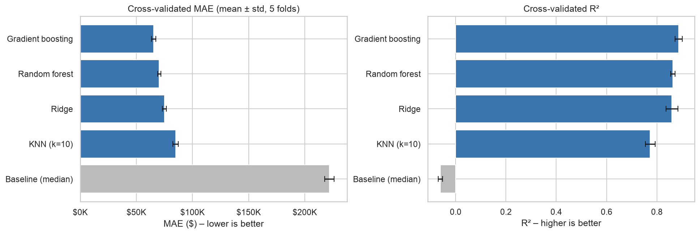
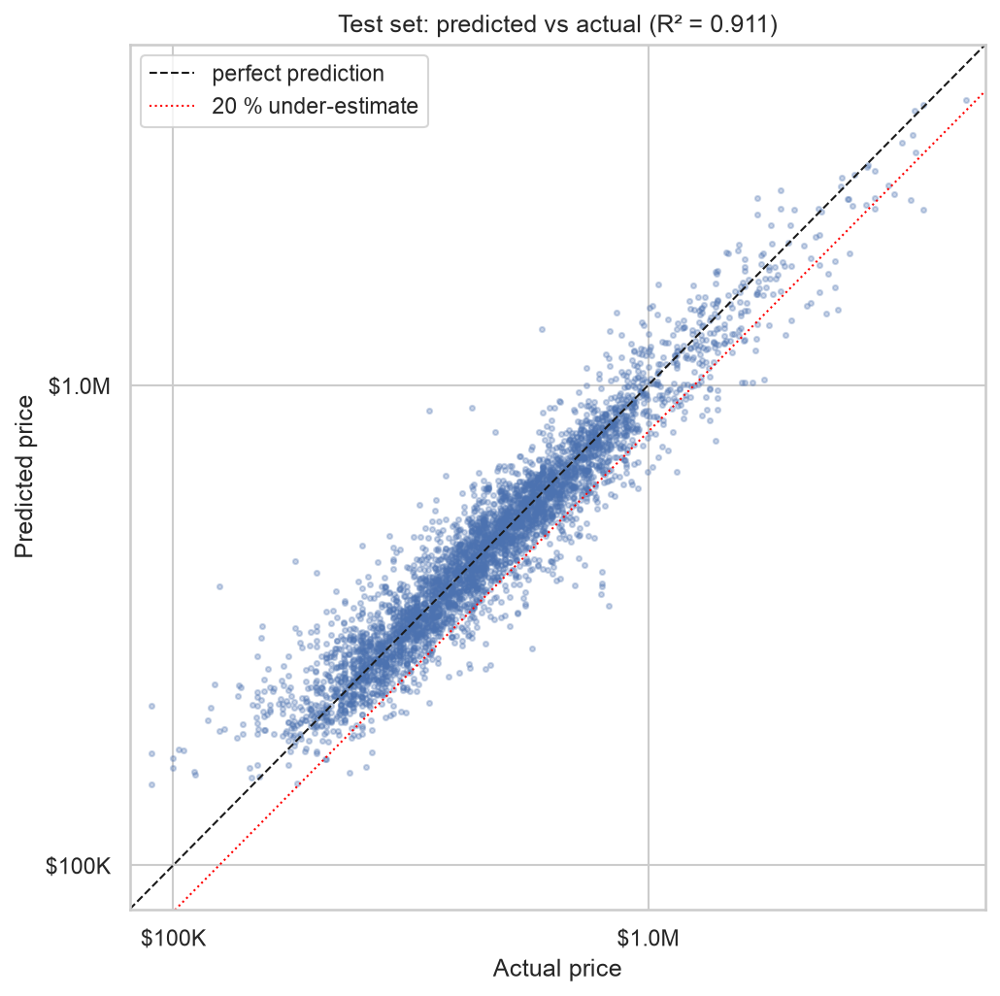
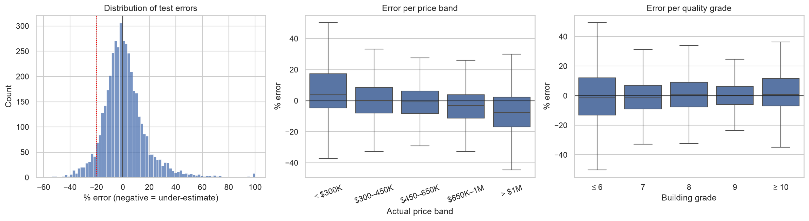
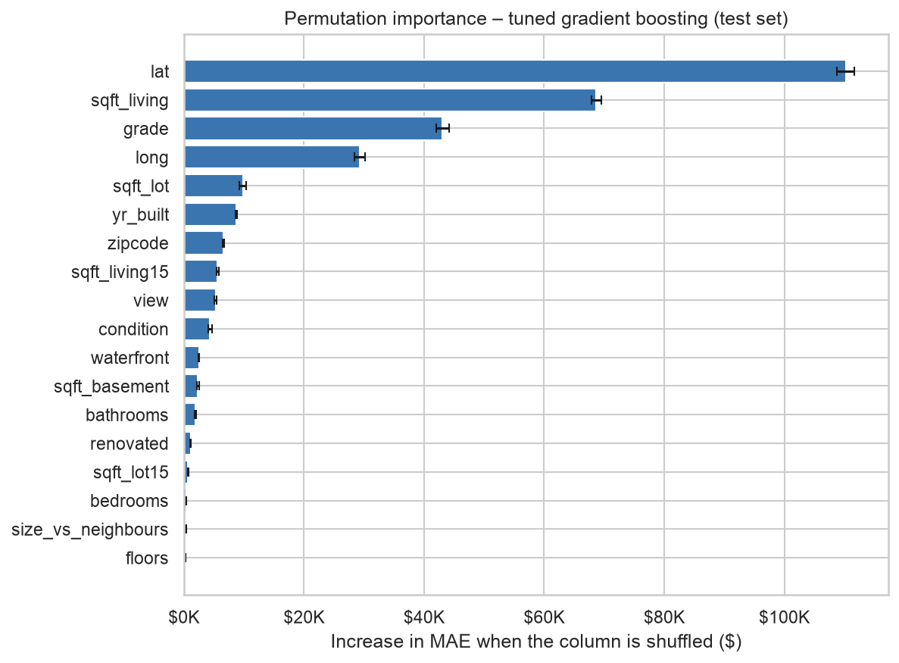

# Predicting house sale prices in King County (Seattle area)

**Team:** Ugochinyere Megwa, Sneha Sachin Shenoy, Álvaro Miñé
**Course:** AI Methods I – Day 2: Supervised learning (IAAC MaAI 2026/27)
**Model on Hugging Face:** https://huggingface.co/iaac-maai/day2-team7-house-price

## Use case

A **real estate agent or small investor** scouting houses to buy in King County wants a quick estimate of what a house is worth, from the facts on a sales sheet: size, rooms, build quality, condition and location. The estimate is compared with the asking price to spot good deals.

The costly mistake is **under-estimating** a house's value: the agent dismisses a good property and misses the deal. Our main metric is therefore the **MAE in dollars**, and we always check *in which direction* the model is wrong (under- vs over-estimates), per price band and per building grade.

## Dataset

| | |
|---|---|
| **Name** | Housing Price Dataset (house sales in King County, Washington, USA) |
| **Source** | [Kaggle – sukhmandeepsinghbrar/housing-price-dataset](https://www.kaggle.com/datasets/sukhmandeepsinghbrar/housing-price-dataset) |
| **Period** | Sales between May 2014 and May 2015 |
| **Rows × columns (raw)** | 21,613 × 21 |
| **Rows used** | 21,418 houses (18 impossible rows removed, and only the most recent sale kept for 177 houses sold twice) |
| **One row is** | one house sale: price, sizes, rooms, floors, quality grade, condition, view, waterfront, year built / renovated, zipcode, latitude / longitude, average size of the 15 nearest houses |
| **Licence** | ⚠️ *to check on the Kaggle page.* The data comes from King County public sales records and is also published on Kaggle as "House Sales in King County, USA" under CC0 (public domain). |

**Why a new dataset?** Our Day 1 dataset (NYC Department of Buildings renovation permits) did not have enough usuable data to form valid predicitions. Because we switched datasets, this repository contains **two notebooks**: the cleaning and EDA of the new dataset, then the supervised learning pipeline.

## Repository structure

```
├── data/
│   ├── .gitkeep
│   └── housing_clean.csv           # cleaned dataset saved by notebook 1 (2.4 MB, committed)
├── figures/                        # plots exported by the notebooks
├── models/
│   └── README.md                   # the Hugging Face model card (model.joblib lives on Hugging Face only)
├── notebook/
│   ├── data_cleaning_and_EDA.ipynb # 1. cleaning and EDA of the King County dataset
│   └── supervised_learning.ipynb   # 2. features, pipeline, model comparison, tuning, test, interpretation
├── .gitignore
├── LICENSE                         # MIT
├── README.md
└── requirements.txt                # pinned library versions
```

## How to run

```bash
python -m venv .venv
source .venv/bin/activate        # Windows: .venv\Scripts\activate
pip install -r requirements.txt
```

1. Download `Housing.csv` from the [Kaggle page](https://www.kaggle.com/datasets/sukhmandeepsinghbrar/housing-price-dataset) and put it in `data/`. The raw file is not committed.
2. Open `notebook/data_cleaning_and_EDA.ipynb`, select the `.venv` kernel and **run all cells**. It creates `data/housing_clean.csv`.
3. Open `notebook/supervised_learning.ipynb` and **run all cells** (about 5 minutes). It exports the figures to `figures/` and saves the trained pipeline to `models/model.joblib`.

To use the trained model without running anything, download it from Hugging Face (see the [model card](models/README.md)).

## Approach

- **Target:** `price` in US dollars (**regression**). The models learn **log(price)** with `TransformedTargetRegressor`, because the price is strongly right-skewed (skewness 4.0 → 0.4 after the log). Predictions and metrics stay in dollars. **Main metric: MAE**, plus RMSE, R² and MAPE.
- **Features (18):**
  - sizes: `sqft_living`, `sqft_lot`, `sqft_basement`, and the neighbours' `sqft_living15` / `sqft_lot15`;
  - rooms and floors: `bedrooms`, `bathrooms`, `floors`;
  - quality and state: `grade`, `condition`, `view`;
  - location: `zipcode`, `lat`, `long`, `waterfront`;
  - age: `yr_built`;
  - two features we built: `renovated` (yes/no) and `size_vs_neighbours` (living area ÷ neighbours' average).
- **Removed:**
  - `id`: an identifier;
  - `date`: all sales are from one year, and the agent wants a value now;
  - `sqft_above`: exactly `sqft_living − sqft_basement`;
  - `yr_renovated`: 0 means "never", so it is replaced by `renovated`;
  - anything built from the price (`price_per_sqft`, `log_price` from the EDA): leakage.
- **Preprocessing** (`Pipeline` + `ColumnTransformer`):
  - numeric columns: median imputation + `StandardScaler`;
  - `grade`, `condition`, `view`: `OrdinalEncoder` with an **explicit order** (ordinal categories stored as numbers);
  - `zipcode`: `OneHotEncoder` (a nominal category stored as a number: 98199 is not "more" than 98001);
  - 0/1 flags: passed through.
- **Split:** 80 % train / 20 % test, `random_state=42`. The test set is used **once**, at the end.
- **Models compared** (5-fold `KFold`, same folds and metrics for all):
  - `DummyRegressor` (median) as the baseline;
  - `Ridge` (linear);
  - `KNeighborsRegressor`;
  - `RandomForestRegressor`;
  - `HistGradientBoostingRegressor`.
- **Tuning:**
  - a validation curve of `max_depth` for gradient boosting;
  - a `GridSearchCV` over learning rate, number of iterations and tree size.

## Results

Cross-validation on the training set (5 folds, mean ± standard deviation):

| Model | MAE ($) | RMSE ($) | R² | MAPE (%) |
|---|---|---|---|---|
| Baseline (median) | 222,072 ± 4,184 | 378,509 ± 24,063 | −0.061 ± 0.008 | 42.2 ± 0.7 |
| Ridge | 74,964 ± 1,692 | 137,588 ± 18,331 | 0.860 ± 0.024 | 13.7 ± 0.2 |
| KNN (k = 10) | 84,965 ± 2,337 | 175,190 ± 18,180 | 0.774 ± 0.019 | 14.6 ± 0.3 |
| Random forest | 70,368 ± 1,399 | 135,381 ± 6,194 | 0.864 ± 0.009 | 12.6 ± 0.1 |
| Gradient boosting | 65,367 ± 1,846 | 123,631 ± 13,318 | 0.887 ± 0.014 | 12.0 ± 0.1 |
| **Gradient boosting, tuned** | **64,011 ± 1,553** | | | |

**What the table shows:**

- **Gradient boosting is clearly best.** It beats the random forest by about $5K MAE (~3 standard deviations, a real difference) and trains 10× faster.
- **Ridge and random forest are tied in R²** (within noise).
- **Tuning gained only $1.4K**, which is within noise. It costs nothing, so we kept it.

**Final model:** tuned `HistGradientBoostingRegressor` (learning rate 0.05, 31 leaves, early stopping).

**Test set (4,284 houses, used once):**

| Metric | Value |
|---|---|
| MAE | **$62,185** |
| RMSE | $108,202 |
| R² | 0.911 |
| MAPE | 11.6 % |
| Median absolute error | $37,085 |

The test MAE agrees with the cross-validation MAE ($64,011).





**Where the model fails:**

| Group | Median error |
|---|---|
| Houses over $1M | −7.5 % (under-estimated) |
| Waterfront houses | −12.8 % (under-estimated) |
| Houses under $300K | +3.7 % (over-estimated) |

The model pulls extreme houses towards the middle of the market, so the costly under-estimates concentrate on luxury and waterfront homes.



**What the model relies on:**

- **Location comes first.** Shuffling the latitude raises the MAE by $110K.
- **Then living area and build quality** (`grade`). Raising a house from grade 7 to grade 9 adds about $129K in our hand-made example.
- **The number of bedrooms adds nothing** once the area is known.
- **Maintenance matters less than quality:** `condition` has much less effect than `grade`.



## Limitations

- **Time and place:** sales from King County (USA), 2014–15 only. Prices are outdated, so use the model for *comparisons* (option A vs B), not for today's absolute values. It does not transfer to other regions or countries.
- **Building types:** residential houses only. The model does not apply to apartments, commercial buildings or empty land. `grade` is King County's own assessor scale.
- **Value range:** there are few luxury and waterfront examples, so these houses are under-estimated. Treat predictions above ~$1M, or for waterfront houses, as a lower bound.
- **Evaluation:** the split is random, so the same neighbourhoods appear in training and test. The scores show how well the model works within known areas and the same year, not in a new area or a future market.
- **Bias:** the model reproduces past market prices, including historical price differences between neighbourhoods. It describes correlations, not causes, and must not be used for decisions about people (lending, insurance).

## AI usage disclosure

| | |
|---|---|
| **Tools** | **Claude** (Anthropic), used as a chat assistant. It helped us write the supervised learning notebook and wrote this README. |
| **Why** | To compare candidate datasets quickly, to learn the scikit-learn pipeline API (`ColumnTransformer`, `TransformedTargetRegressor`, `cross_validate`), and to save time on plotting code and documentation. |
| **Where** | Dataset choice (comparing two Kaggle datasets and a Hugging Face dataset against the brief); EDA plot ideas and code (price vs living area, the bathroom counts, "bigger than the neighbours", the waterfront premium); the outlier discussion; the full `supervised_learning.ipynb` (pipeline, model comparison, per-model graphs, tuning, test evaluation, interpretation, written comments); `requirements.txt`, `.gitignore` and this README. |

## License

Code released under the [MIT License](LICENSE). The dataset is subject to its own licence (see above).
